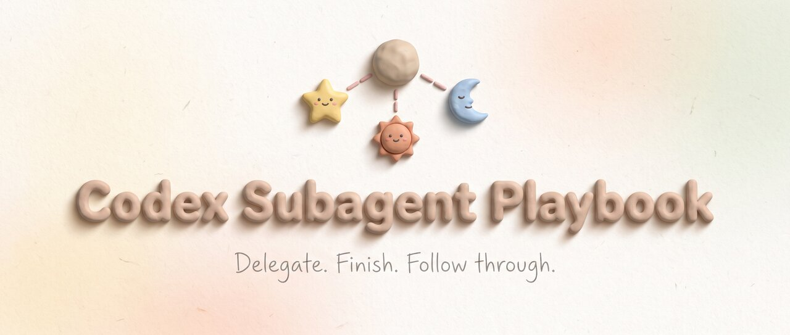

# codex-subagent-playbook



[](https://developers.openai.com/codex/cli)
[](https://developers.openai.com/codex/skills/)
[](LICENSE)

Get more completed work out of your Codex subscription. This plugin puts Luna to work on implementation from your design document or work plan, uses Sol for design and Astra for research and review, and cuts unnecessary check-ins with the parent session.

The plugin contains one Agent Skill. Use it with individual subagents or an existing workflow.

---

## Quick Start

Requires the latest Codex CLI and access to GPT-6.2 Astra, GPT-6.2 Sol, and GPT-6 Luna.

Register the marketplace directly from GitHub:

```bash
codex plugin marketplace add shinpr/codex-subagent-playbook
```

In Codex, open `/plugins`. Find **Subagent Playbook** in **Codex Subagent Playbook**, install it, and start a new session. You can confirm the installation by opening the skill picker and checking that `subagent-playbook:subagent-delegation` is listed.

The skill can activate automatically when Codex considers or manages subagents. For a first task, try:

```text
Use subagents to implement this work plan and review the result.
```

To request the skill explicitly, select `subagent-playbook:subagent-delegation` from the skill picker before sending your request.

---

## Model Selection

Give Codex your design document or work plan so Luna can handle implementation.

| Task | Model | Effort |
|---|---|---|
| Analysis, research, and direction setting | Astra | medium |
| Design | Sol | high |
| Implementation with a design document or work plan | Luna | max |
| Implementation without either document | Sol | high |
| Review | Astra | medium |
| Urgent work, including incident investigation and response | Sol | high |

For web UI appearance changes, also supply a UI specification or mockup to use Luna; otherwise, Codex uses Sol high. Urgent work uses Sol high regardless of task type. Your explicit model choices and existing host or role constraints take precedence over these defaults.

<details>
<summary>Background on the defaults</summary>

- [Reasoning Effort Is Not a Quality Setting](https://www.norsica.jp/blog/reasoning-effort-is-not-a-quality-setting) compares design, implementation, and review across several configurations, including Sol high and Luna max.
- [Astra and Sol in Galley: Evaluation Methods and Results](https://www.norsica.jp/resources/astra-effort-evaluation) compares Astra effort levels with Sol high in analysis, implementation, and code review.

</details>

---

## Fewer Check-ins

Each subagent progress message wakes the parent session to process the update and respond.

With this plugin, subagents work through implementation and verification, contacting the parent when they need a decision or help, or when you request an update. The parent waits for those notifications or the completed result. You can change direction while work is running.

Small tasks can stay in the main session when delegation would add more overhead than value. Before reporting completion, Codex checks the results and carries out any required review.

---

## License

[MIT](LICENSE)
