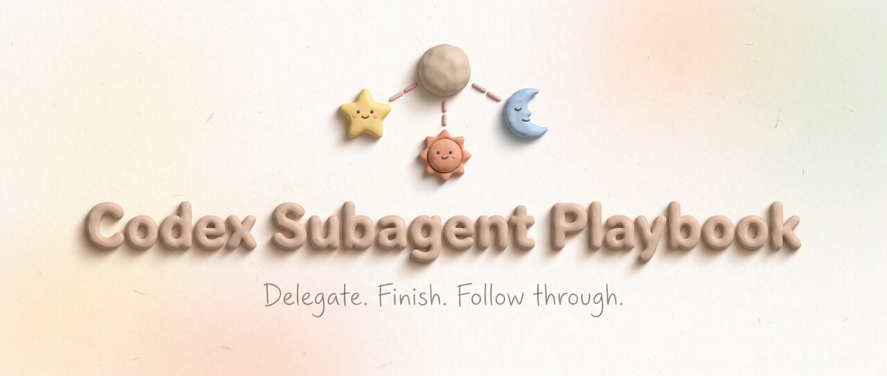

# codex-subagent-playbook



[](https://developers.openai.com/codex/cli)
[](https://developers.openai.com/codex/skills/)
[](LICENSE)

Get more completed work out of your Codex subscription. This plugin helps Codex balance subagent quality and token cost: it matches models and reasoning effort to each task, and cuts the check-ins that spend your budget while another agent is working.

The plugin contains one Agent Skill. Use it with individual subagents or an existing workflow.

---

## Quick Start

Requires the latest Codex CLI and access to GPT-6 Astra, GPT-6.1 Sol, and GPT-6 Luna.

Register the marketplace directly from GitHub:

```bash
codex plugin marketplace add shinpr/codex-subagent-playbook
```

In Codex, open `/plugins`. Find **Subagent Playbook** in **Codex Subagent Playbook**, install it, and start a new session. You can confirm the installation by opening the skill picker and checking that `subagent-playbook:subagent-delegation` is listed.

The skill can activate automatically when Codex considers or manages subagents. For a first task, try:

```text
Use subagents to implement this work plan and review the result.
```

To request the skill explicitly, select `subagent-playbook:subagent-delegation` from the skill picker before sending your request.

---

## Model Selection

The defaults use Luna for implementation from supplied documents to keep execution costs down. Astra handles research and review, where judging what is worth changing matters and tasks consume more input than output. Sol handles design after the direction has been set. These choices reflect the author's measurements and daily use.

| Task | Model | Effort |
|---|---|---|
| Analysis, research, and direction setting | Astra | medium |
| Design | Sol | high |
| Implementation | Luna | max |
| Review | Astra | medium |
| Urgent work, including incident investigation and response | Sol | high |

These are the model and effort choices Codex applies when starting a child. Explicit user choices and existing host or role constraints take precedence.

The implementation and urgency rules are:

- Implementation uses Sol high when neither a design document nor a work plan is designated as an input.
- Creating or changing a web UI's appearance also requires a UI specification or mockup to use Luna. Otherwise, it uses Sol high.
- Urgent work uses Sol high, taking precedence over the ordinary task categories.

The implementation rules check which inputs are supplied, not whether their contents pass a design review. Point Codex to the documents you already have; work can proceed with Sol high when those inputs are absent. The web UI rule reflects the author's experience with UI generation.

<details>
<summary>Background on the defaults</summary>

- [Reasoning Effort Is Not a Quality Setting](https://www.norsica.jp/blog/reasoning-effort-is-not-a-quality-setting) compares design, implementation, and review across several configurations, including Sol high and Luna max.
- [Astra and Sol in Galley: Evaluation Methods and Results](https://www.norsica.jp/resources/astra-effort-evaluation) compares Astra effort levels with Sol high in analysis, implementation, and code review.

These are case studies from one repository. They inform the defaults alongside daily use; the web UI rule remains an experience-based choice rather than a result of these evaluations.

</details>

---

## Delegation

In one recorded development task, Luna max added a persistent cache across two application entry points, covering reuse, invalidation, failure recovery, and deletion. It passed 99 tests and returned the implementation in about 27 minutes, for roughly $0.38 in API-equivalent token cost. A routine progress notification made the Sol parent process another 67k input tokens, mostly cached, costing about $0.009 including its response.

These estimates use the October 10, 2026 Standard API rates for [Luna](https://developers.openai.com/api/docs/models/gpt-6-luna) and [Sol](https://developers.openai.com/api/docs/models/gpt-6.1-sol), including cached input and reasoning output.

This plugin gives subagents time to finish implementation and verification, with interim messages when a decision or help is needed, or when you ask for an update. The parent waits for those notifications. Small tasks can stay in the main session when delegation would add more overhead than value.

You can change direction while work is running. Before reporting completion, Codex checks the results and carries out any required review.

---

## License

[MIT](LICENSE)
